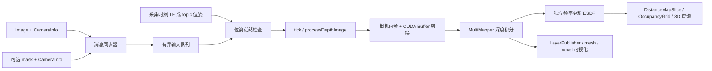

# Isaac ROS nvblox：初步源码分析

分析日期：2026-10-06。基线：`release-5.0` / `edf0484edbf3d6380f739b23a4cf1c7ba6d6e088`。本轮只做静态阅读与中文注释，没有运行 ROS、构建 CUDA、下载子模块或验证地图精度。

## 项目职责与初步范围

这个仓库提供 nvblox 几何建图核心的 ROS 包装：带标定位姿的深度/彩色图像或点云进入 GPU mapper，得到 TSDF/occupancy、ESDF、网格与导航距离切片。`isaac_ros_nvblox` 是聚合入口，主要组件来自 `nvblox_ros`。几何地图描述观测到的空间，不等于学习式世界模型对未来状态的预测。见[官方包入口](https://nvidia-isaac-ros.github.io/repositories_and_packages/isaac_ros_nvblox/isaac_ros_nvblox/index.html)和[几何建图说明](https://nvidia-isaac-ros.github.io/concepts/scene_reconstruction/nvblox/technical_details.html)。

本轮注释以下 8 个核心文件；其它节点、CUDA 核心、可视化、Nav2 插件、测试和传感器示例尚未逐一分析。精确范围见 [annotation_scope.json](annotation_scope.json)。

| 文件 | 本轮重点 |
|---|---|
| [nvblox launch](../nvblox_examples/nvblox_examples_bringup/launch/perception/nvblox.launch.py) | 相机/模式分支、topic remapping 与参数覆盖顺序 |
| [vslam launch](../nvblox_examples/nvblox_examples_bringup/launch/perception/vslam.launch.py) | camera0 双目位姿来源与 release-5.0 参数接口 |
| [nvblox_node.hpp](../nvblox_ros/include/nvblox_ros/nvblox_node.hpp) | 消息元组、同步策略、队列、地图与 GPU 缓存 |
| [nvblox_node.cpp](../nvblox_ros/src/lib/nvblox_node.cpp) | 订阅→tick→深度/彩色/点云积分→ESDF/服务 |
| [nvblox_node_impl.hpp](../nvblox_ros/include/nvblox_ros/impl/nvblox_node_impl.hpp) | 就绪筛选、锁范围和有界丢弃队列 |
| [transformer.hpp](../nvblox_ros/include/nvblox_ros/transformer.hpp) | TF/topic 位姿来源与缓存约定 |
| [transformer.cpp](../nvblox_ros/src/lib/transformer.cpp) | `T_global_sensor` 查询和时间匹配实际算法 |
| [image_conversions.cpp](../nvblox_ros/src/lib/conversions/image_conversions.cpp) | CameraInfo、深度单位与 CUDA Buffer 图像边界 |

另外核对了 `.gitmodules`、README、CMake/包依赖、基础和 RealSense YAML、相机/模式枚举、参数默认值、`DistanceMapSlice` / `EsdfAndGradients` 接口与深度转换 CUDA helper。只读范围也列在 manifest，不能把本轮阅读范围理解为整个仓库均已理解。

## 从深度帧到地图的主线

构造时先初始化参数和 `Transformer`，注册订阅/发布/服务，再构建静态/动态 `MultiMapper`，最后启动 wall timer。订阅回调只缓存观测；互斥 processing callback group 的 `tick()` 依次处理服务、深度、彩色和 LiDAR，再按各自频率更新衰减、清图、ESDF 与可视化。

普通图像+CameraInfo 使用 `ExactTime`。深度+mask+两套标定使用 `ApproximateTime`，彩色+mask+两套标定使用 `ExactTime`。同步器只匹配消息；地图积分还需对应采集时刻的 TF。队列就绪检查会分别核对 image 与 mask 位姿。

`processDepthImage` 根据 frame 的上一积分时刻限频，丢弃清图之前的旧帧；查询 `T_global_depth` 和可选 `T_global_mask`，构造 `T_mask_depth = inverse(T_global_mask) * T_global_depth`。随后读取相机内参、转换设备图像并调用 `MultiMapper::integrateDepth`。无 mask 分支额外传入由纳秒除 `1e6` 得到的更新毫秒时间。彩色与 LiDAR 有各自限频；LiDAR 运动补偿还需要逐点时间及扫描结束时刻位姿。

## 输入输出契约

| 接口/配置 | 已读源码中的语义 |
|---|---|
| `camera_i/depth/{image,camera_info}` | 第 i 路深度与标定；节点最多四路，launch 示例各有约束 |
| `camera_i/color/{image,camera_info}` | 彩色与标定，积分频率独立于深度 |
| `camera_i/mask/{image,camera_info}` | 可选 `mono8` 掩码及其内参，分割/检测工作流负责生成 |
| 深度编码 | Buffer 路径接受 `32FC1` 米单位 float，`16UC1` / `mono16` 由 helper 除 `1000` 转米 |
| 彩色编码 | 当前转换接受 `rgb8` / `bgra8`；不是任意 ROS 图像编码均可直接积分 |
| CameraInfo | 转换读取 K 中 fx/fy/cx/cy 与宽高，不利用 D/R/P 执行畸变或整流 |
| `global_frame` / `pose_frame` | 节点默认 `odom` / `base_link`；传感器外参和 topic 位姿必须与此约定一致 |
| `~/static_map_slice` | `DistanceMapSlice`，行主序距离值，单位米，含分辨率、原点和未知哨兵值 |
| `~/static_occupancy_grid` | 从距离切片产生的 ROS OccupancyGrid；并非直接输出 TSDF 体素值 |
| `~/get_esdf_and_gradient` | 三维 ESDF/AABB 查询与可选形状清理；响应注明 global frame、体素大小与最新积分时间 |

release-5.0 通过 `cuda_buffer_backend::from_input_buffer` 取得标准 Image 的设备读句柄，订阅允许 CPU/CUDA Buffer 后端。Buffer 接口包含必要的传输/同步处理，但这不保证所有相机都零拷贝。图像转换按 width×height 处理；当前所读转换函数没有使用 `image.step` 修正逐行 padding，输入应另核对连续布局与编码。

默认 YAML 是 `static_tsdf`、`voxel_size=0.05` 米、`esdf_mode=2d`。深度 40 Hz、颜色 5 Hz、ESDF 10 Hz 与发布层 5 Hz 是示例参数，不是保证达到的测量性能。三维 ESDF 服务在二维配置下会调用 `exit(1)`；开始 cuMotion 三维碰撞地图练习前必须先理解这一差别。

## launch 配置层次和 TF 来源

`perception/nvblox.launch.py` 用 `mode` 与 `camera` 枚举名称选择 remapping，再按 **基础 YAML → 模式 YAML → 传感器 YAML →显式覆盖参数** 加入组件。`run_standalone` 控制容器创建；插件为 `nvblox::NvbloxNode`。

RealSense 中 camera0 的深度来自 splitter，其余相机直接接深度 topic；人像分割模式改用缩放后的彩色与 CameraInfo。nvblox 的多相机示例不代表 cuVSLAM 同时使用所有相机：本仓库 VSLAM launch 只把 camera0 的双目送去跟踪，并关闭 `enable_localization_n_mapping`，使用 VO 的 TF 链。

`Transformer` 默认从 tf2 查询 `T_global_sensor(t)`。启用 topic 位姿时，缓存按约定输入的 `T_global_pose(t)`，再乘首次查询并缓存的 `T_pose_sensor`。topic 回调忽略消息 frame 标识，需要发布方保证语义；时间零取最新位姿，非零查询使用 `lower_bound` 选择不早于请求时刻的第一项，容差为 `1e8 ns = 100 ms`。

## 子模块与外部运行条件

`.gitmodules` 指向 `nvidia-isaac/nvblox` 的 `public` 分支；基线 `nvblox_ros/nvblox_core` gitlink 是 **`24eee4948768682fa1ffb969b881efee4fca29c2`**。核心为独立 C++/CUDA 库，本轮未初始化/递归下载。见[固定核心源码](https://github.com/nvidia-isaac/nvblox/tree/24eee4948768682fa1ffb969b881efee4fca29c2)。

ROS CMake `add_subdirectory(nvblox_core)` 一起构建核心，关闭 PyTorch wrapper 与 standalone renderer，另依赖 CUDA Toolkit / `cuda_buffer`、ROS 2、tf2、message_filters、cv_bridge、glog/gflags、`isaac_ros_common`。相机驱动、VSLAM、分割/检测模型和 Nav2 系统是相邻依赖，不能因 fork 了这个仓库就认为已完成安装。环境版本以 [Isaac ROS 5.0 发布说明](https://nvidia-isaac-ros.github.io/releases/index.html)为准；本轮没有验证本机硬件能运行。

## 现有源码中需要单独验证的点

- `vslam.launch.py` 的 `if camera is NvbloxCamera.realsense or NvbloxCamera.multi_realsense` 第二项是恒为真的枚举对象，不能理解成两次相机比较。
- 该 launch 仍追加 `enable_imu_fusion`、`rig_frame` 和 `enable_rectified_pose`，当前所读 release-5.0 cuVSLAM 节点不声明/消费这些字段；真正的 IMU 模式选择是 `tracking_mode=1`。这一组合尚未进行 launch 行为复现。
- `Transformer::lookupTransformQueue` 原注释称“最近邻”，实现只取 `lower_bound` 右侧项，没有比较左侧项，也没有插值。topic 队列回调没有 frame 校验或历史淘汰，传感器外参缓存不跟随每帧更新。
- `processQueue` 在处理前移出就绪项，并忽略 `process_function` 的返回值；深度/彩色包装 lambda 也无条件返回 true。因此后续转换或积分失败不会按此模板自动重试。
- 三维 ESDF 查询与二维导航切片不能混用；默认 2D 配置下调用三维服务会退出节点。

本轮保持全部原始代码和值不变。这些是可定位的静态观察，运行影响与修复方案留给后续实验。

## PyRoki → 几何地图 → WLA 的研究连接

PyRoki 的 SE(3) 组合帮助理解 `T_global_camera`；cuVSLAM 提供连续里程计参考；nvblox 把深度变成可供碰撞/规划查询的几何表示；cuMotion 可以进一步消费三维 ESDF。WLA 的预测、状态编码和动作表示需另建契约与适配器，当前 mapper 不是其训练 world model，也未建立自动连接。

第一项静态练习：选择单 RealSense、static 模式，把 depth remapping → ExactTime → depth queue → `isPoseAvailable` → `processDepthImage` → `integrateDepth` → `processEsdf` → `DistanceMapSlice` 写成一张表。每一行记录时间单位、frame_id、深度单位、内参来源和失败时是否保留队列项；随后比较 2D 切片与 3D AABB 服务各适合哪种任务。完成后再使用录包测量定位延迟、地图质量和控制接口。

## 2026-10-06 本地提交授权

用户已明确授权将 PyRoki、WLA 和 5 个 Isaac ROS 仓库的本轮注释、代码树及分析材料提交到各自学习分支。本文中“未提交／等待审查”描述的是准备阶段；本轮将创建本地 commit，验证仍使用固定上游基线。提交版本统一登记在学习流水线的提交记录中。运行实验尚未执行。
